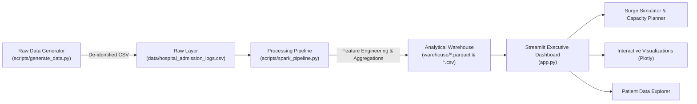

# Hospital Patient-Flow Analytics & Administrator Operations Dashboard

An end-to-end Big Data & Clinical Operations Command Center built with PySpark, Pandas, Streamlit, Plotly, and Docker.

---

## 🏛️ Architecture Overview



---

## 📁 Repository Directory Structure

```
mini_project/
├── data/
│   └── hospital_admission_logs.csv        # 3,500 de-identified patient admission/discharge records
├── warehouse/
│   ├── enriched_admissions.parquet        # Feature-engineered dataset (Parquet)
│   ├── enriched_admissions.csv            # Feature-engineered dataset (CSV)
│   ├── department_metrics.parquet         # Aggregated ward throughput & LOS KPIs (Parquet)
│   ├── department_metrics.csv             # Aggregated ward throughput & LOS KPIs (CSV)
│   ├── hourly_heatmap_metrics.parquet     # Day-of-week vs. hour-of-day intake metrics (Parquet)
│   ├── hourly_heatmap_metrics.csv         # Day-of-week vs. hour-of-day intake metrics (CSV)
│   ├── daily_flow_metrics.parquet         # Daily timeline admission trends by department (Parquet)
│   └── daily_flow_metrics.csv             # Daily timeline admission trends by department (CSV)
├── scripts/
│   ├── generate_data.py                   # Realistic hospital log simulation engine
│   └── spark_pipeline.py                  # PySpark feature engineering and ETL pipeline
├── app.py                                 # Streamlit operations command center
├── Dockerfile                             # Production container definition (Python 3.11 + JRE)
├── docker-compose.yml                     # Multi-port container orchestration
├── requirements.txt                       # Project Python dependencies
└── README.md                              # System documentation
```

---

## 🚀 Quickstart & Execution

### 1. Generate Synthetic Data
```bash
python scripts/generate_data.py
```
*Generates 3,500 realistic admission records with department-specific Length of Stay (LOS) distributions, acuity weights (ESI 1-5), and disposition trajectories.*

### 2. Run the Processing Pipeline
```bash
python scripts/spark_pipeline.py
```
*Processes the logs, calculates exact `los_hours`, breaks down temporal intake patterns, computes department metrics, and saves dual Parquet and CSV layers in `warehouse/`.*

### 3. Launch the Executive Dashboard
```bash
streamlit run app.py --server.port=8502 --server.headless=true
```
Access the dashboard at [http://localhost:8502](http://localhost:8502).

---

## 🐳 Docker Deployment

Build and run using Docker Compose:
```bash
docker compose up --build -d
```
Access the dashboard at `http://localhost:8501` or `http://localhost:8502`.

---

## 📊 Dashboard Modules

1. **Top Executive KPIs**:
   - Total Ingested Admissions
   - System Average Length of Stay (hours and days)
   - Highest Volume Ward & Share
   - System Acuity Severity Index (% Critical / Emergent)
   - Clinical Disposition Outcomes (% Discharged Home, Mortality Rate)

2. **Visualizations**:
   - **Throughput vs. Stay**: Interactive dual-axis chart comparing departmental volume and average LOS.
   - **24-Hour Patient Arrival Heatmap**: Day of week vs. hour of day intake patterns with Viridis color intensity.
   - **Daily Flow Timeline**: Multi-department daily census trajectory with date filtering.

3. **Dynamic Bed Capacity & Surge Simulator**:
   - Interactive intake surge slider (+0% to +100%).
   - Calculates real-time projected concurrent occupancy using Little's Law ($L = \lambda \cdot W$).
   - Dynamically highlights ward bottlenecks exceeding safe operating capacity (85% and 100%).
   - Automatic Emergency Surge Protocol status triggers (Green / Yellow Advisory / Red Emergency).

4. **De-Identified Patient Admissions Explorer**:
   - Multi-parameter filtering by Department, Disposition, and Acuity Score.
   - Search by Patient ID or Admission ID.
   - Real-time filtered CSV export button.
